# Replacement artwork integration

Implements [issue #1](https://github.com/jxav22/baga-and-friends/issues/1).
Reviewed on 2026-11-27 (Pacific/Auckland) with Godot 4.3, Compatibility rendering.

## Source of truth

- `art/replacements/` is the immutable set of 46 candidates from `2d185fc`.
- `art/production/` holds reviewed refinements: the clean room, folded-collar coat,
  and hidden body backing. Generation provenance is in `art/production/PROMPTS.md`.
- `scripts/prepare_art.py` packs these sources into the stable `assets/` paths.
  This is the only promotion/build step. It does not generate new art or call APIs.
- `art/production/manifest.json` accounts for every candidate, including original
  dimensions, alpha range, visible bounds, runtime destination and wearable anchors.
- `scripts/generate_art.py` is historical. Its output is now confined to the ignored
  `export/legacy-art/` directory; it cannot overwrite approved source or runtime art.

```sh
python -m pip install Pillow==12.2.0
python scripts/prepare_art.py
python scripts/prepare_art.py --check
godot --headless --import --path .
godot --headless --path . --scene res://scenes/SmokeTest.tscn
mkdir -p export/web
godot --headless --path . --export-release "Web" export/web/index.html
```

`--check` compares decoded pixels and the manifest, so PNG compression differences
across platforms are harmless. CI checks committed outputs; it never copies old art
back over them. Source candidates, review images, and inactive duplicate scenes are
excluded from the Web package.

## Active consumers and mapping

`project.godot` starts `scenes/Boot.tscn`, then `autoload/SceneRouter.gd` selects the
top-level scenes. The similarly named `scenes/boot`, `scenes/baga`, and
`scenes/main_room` directories are legacy and were not modified.

| Candidates | Runtime | Handling |
| --- | --- | --- |
| `baga/*.png` (8) | `assets/baga/` | Seven registered layers; preview is rebuilt in scene draw order. |
| `chungus/chungus.png` | `assets/chungus/chungus.png` | Uniform fit and transparent padding to 280×240. |
| `chuggadi/chuggadi.png` | `assets/chuggadi/chuggadi.png` | Uniform fit and transparent padding to 180×180. |
| Eight wearable objects | `assets/cosmetics/` | Padded onto the same 256×320 origin as Baga; coat uses the reviewed refinement. |
| Four room objects | `assets/cosmetics/` | Preserve 320×120, 120×160, 140×90 and 100×120 canvases without stretching. |
| Twelve cosmetic icons | `assets/cosmetics/*_icon.png` | Candidate icons are references; rebuild from the matching unregistered object on 96×96 with five-pixel margins. |
| `room/main_room.png` | `assets/room/main_room.png` | Source for the sharper 1280×720 production room; no purchasable decor is baked in. |
| Cashew, teacup, six memory faces, card back (9) | `assets/shared/` | Uniform fit into existing logical sizes. Cashew duplicate in `assets/minigames/cashew/` stays synchronized. |
| `ui/coin.png`, `ui/panel.png` (2) | Intentionally unused | No active texture consumers. Numeric coins and existing scalable theme panels remain; avoid new UI solely to consume candidates. |

All 46 candidates are accounted for; 45 runtime PNGs are produced, including the
extra cashew copy. Catalog IDs, prices, save schema, navigation APIs, collision
rectangles, movement and reward formulas are unchanged.

## Registration and visual decisions

The original candidate pieces partition visible pixels, leaving cut edges. The
pipeline rebuilds each piece from the assembled target under its original mask,
with two pixels of matching overlap. A confined body backing fills the hidden torso;
the assembled face supplies the missing head centre. The seven separate transparent
layers retain their common 256×320 canvas. Their parent `Layers` still handles idle
bob, pet rotation, feed squash and rest modulation together. Default `preview.png`
is composed from the final layers, so Boot, Cashew Catch and the app icon agree.

Wearable anchors are explicit boxes in `prepare_art.py` and the manifest. Nothing is
individually centered in Baga's canvas. Overlay order remains outfit, feet,
accessory, hat. The coat's hood is folded down to clear the face and its matching shop
icon uses the same refinement. Existing shirt modulation remains; hidden backing
and coat coverage prevent see-through torso holes. Unequipping restores the shirt.

Room decor remains behind Baga and ignores mouse input. The portrait moved onto a
clear wall; plant, cushion and rug were placed to suit the new furniture and keep
navigation clear. HUD backing uses the existing theme for contrast. The same theme
now supplies readable labels in shop, dress-up, tutorial and minigames. Texture
filtering is linear for the painted artwork. Fixed 16:9 content letterboxes other
browser shapes instead of cropping the background independently from the character.

Memory Garden uses one shared card back on every face-down card, including after a
mismatch. Face identities, matching, disabled matched cards and rewards are unchanged.
The existing tutorial panel covered the care controls during practice; it now moves
above them for Pet and Feed, with Chuggadi alongside it.

## Validation

- Godot 4.3 import: clean, no missing resources or script errors.
- `prepare_art.py --check`: passes for 45 PNGs and all 46 candidates.
- Extended smoke: `SMOKE PASS`; tests texture contracts, all twelve purchases and
  equip/unequip paths, four simultaneous wearable slots, all room decorations,
  care, version-1 save round-trip, tutorial Pet/Feed, cashew collision, five tea
  pours, memory mismatches/matches and rewards awarded only once.
- The smoke and visual-review harnesses restore the previous save on normal exit.
- Native Compatibility render: 27 screenshots cover each wearable, combined slots,
  pet/feed/rest transforms, unequip, each decoration, shop, tutorial and minigames.
- Web export: succeeds with the existing single-threaded setting.
- Local WebGL browser: tutorial Pet/Feed, shop purchase (25 → 5 coins), beanie equip,
  dress-up and reload persistence, tea pours, memory reveal/mismatch, Cashew Catch
  keyboard movement/catches, completed round (+12 coins), and navigation verified.
  Console has no game errors.
- Browser layouts inspected at 1280×720, 960×540 and 640×800 (letterboxed).
- PR workflow runs asset check, import, smoke, Web export and itch packaging. Pages
  deployment and `gh-pages` publication run only on `main`, not during PR validation.

To recreate the full in-engine review (requires a graphical renderer):

```sh
godot --path . --scene res://scenes/ArtReview.tscn -- --output=export/art-review/after
```

Baseline screenshots were taken before texture replacement. Review images below
pair baseline on the left with the integrated game on the right.

## Before and after

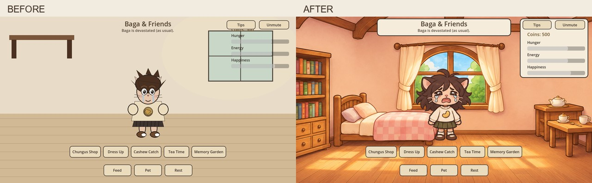
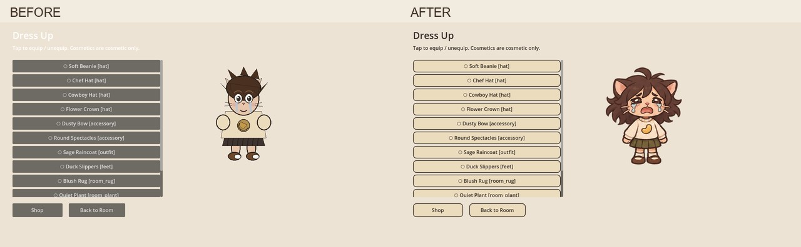
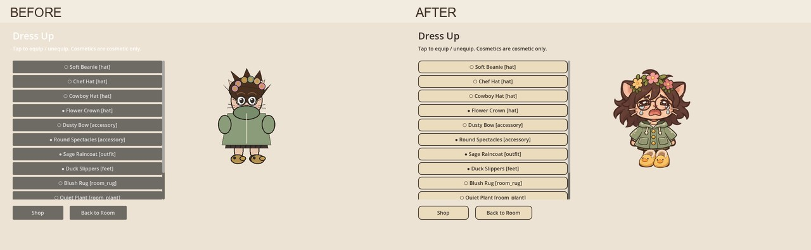
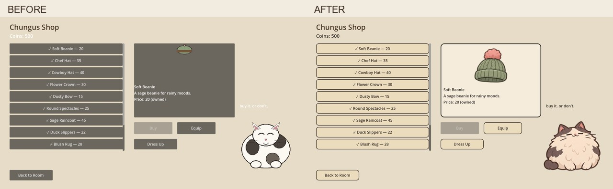
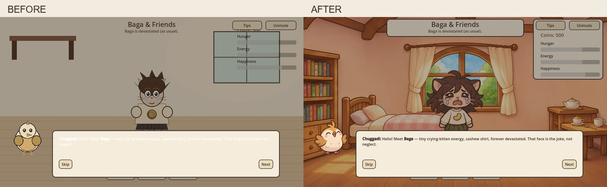
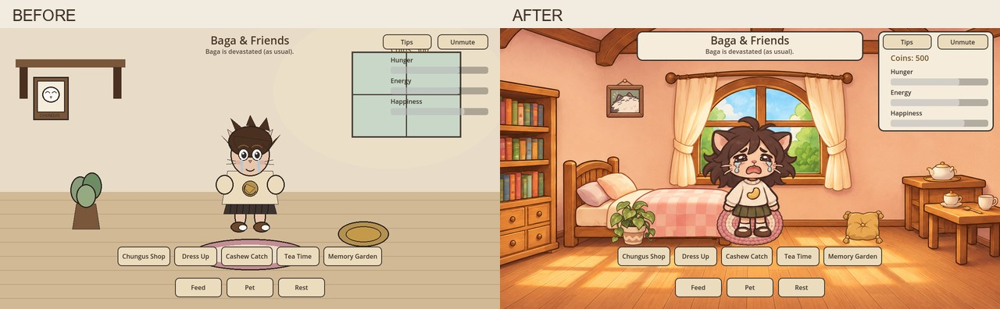
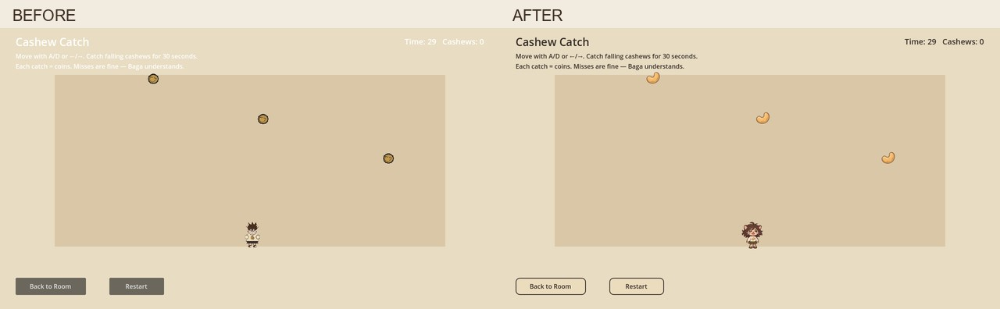
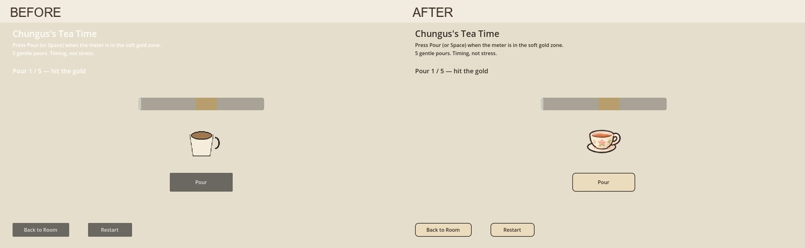
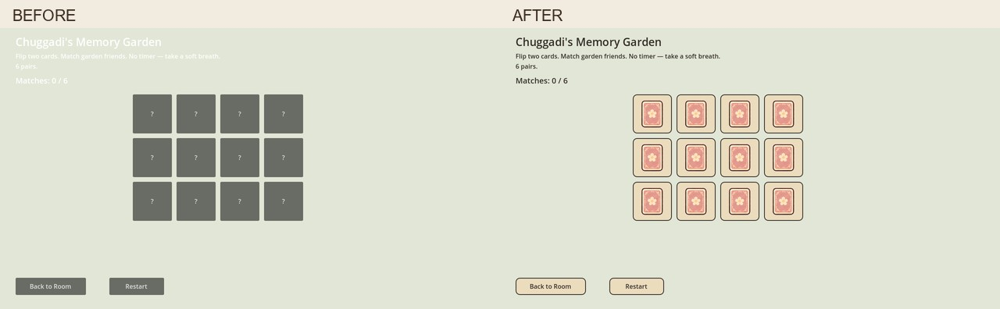
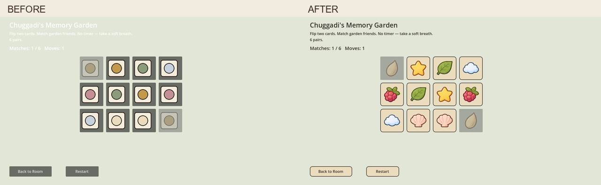
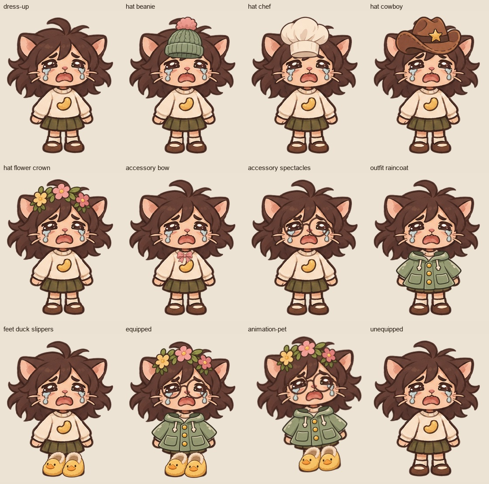

## Visual limits

This is the existing fixed-pose layered character, not an independently articulated
paper doll. Hidden overlap supports the current shared transforms; a future feature
that moves hair, limbs or facial features independently needs additional underpainting.
Small UI candidates (notably the teacup) remain limited by source resolution. Room
decor retains its original logical canvases with padding, so the oval rug is more
compact than its old stretched placeholder. Unused coin/panel candidates remain
available for a future UI task. Some existing symbolic UI characters use missing
font glyphs in Web exports; plain text and the new artwork remain readable.
